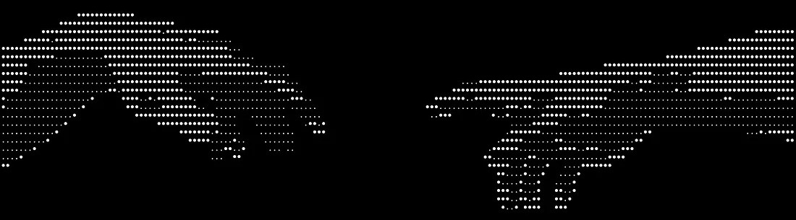

<h3 align="center">welcome</h3>

  i'm into Python, rust, bit of C# and tinkering with Raspberry Pis & Linux. 
  happy to chat if u want to join one of the discords below.  
  I use arch linux on my laptop. i have a repo with my config files for hyprland  
  (i make a lot of terminal app projects btw)

---

## Communities

  

💡 Need help with anything on this GitHub? Open a ticket in the support Discord.

---

## Tech Stack

  

## Featured Projects

###  [mste](https://github.com/markart25/mste)
a small nano-like terminal text editor written in Python with `curses`. Zero dependencies, familiar nano keybindings, published on the AUR — install with `yay -S mste`.

  
  
  
  
  
  
  

###  [facial_sentiment_analisys](https://github.com/markart25/facial_sentiment_analisys)
facial sentiment analysis — detecting emotions from faces using Python.

  
  
  
  
  
  
  

### [markdots](https://github.com/markart25/markdots)
my Arch Linux + Hyprland setup. Configs for the window manager, terminal, waybar, wallpaper scripts and everything else that makes my laptop look good. A install guide is included

  
  
  
  
  
  
  

###  [bosif](https://github.com/markart25/bosif)
a terminal OSINT tool written in Python. You give it whatever info you have — a name, username, email, domain, IP, or phone — and it fans out across public sources (600+ platforms via WhatsMyName, Gravatar, DNS, geolocation, libphonenumber) to fill in the blanks. Zero API keys, stdlib-only.

  
  
  
  
  
  
  

###  [penknife](https://github.com/markart25/penknife)
a tiny TUI launcher for your pentest toolkit — pick a tool, pick a preset, launch.

  
  
  
  
  
  
  

###  [markfolio](https://github.com/markart25/markart25.github.io) --  markart25.github.io
my project portfolio that builds itself from GitHub and themes itself from the wallpaper — pywal, but for a website.

  
  
  
  
  
  
  

---

## Stats

  
   
  

  

  

